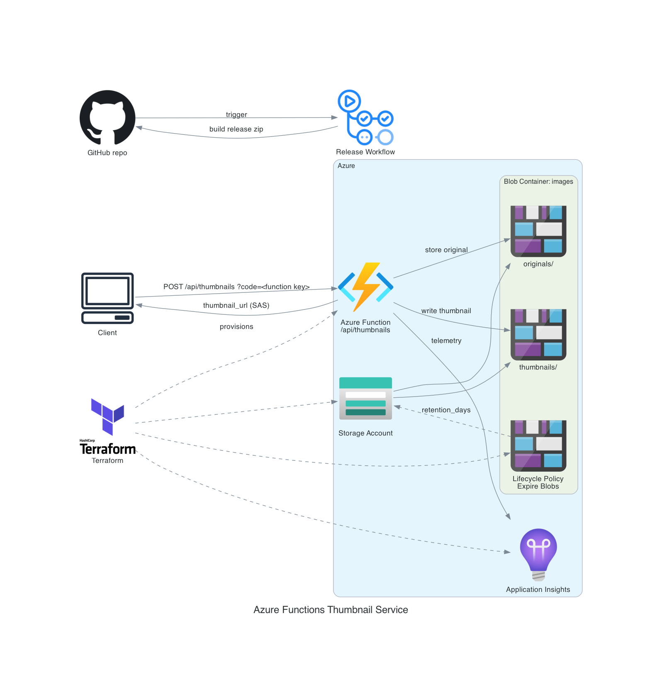

# thumbnail-generation-petproject

A pet project created to validate AI-assisted software delivery using **copilot-bridge-mcp**. The infrastructure was designed and generated by **Copilot**, while the Azure Function application code and unit tests were generated by **Kiro**. The project accepts an uploaded image, creates a thumbnail, stores both files in Azure Blob Storage, and returns metadata including a temporary SAS URL for the generated thumbnail.

## Architecture

The diagram is generated from [docs/architecture.py](docs/architecture.py) with the Python [`diagrams`](https://diagrams.mingrammer.com/) library (needs [Graphviz](https://graphviz.org/download/)):

~~~bash
pip install diagrams
python docs/architecture.py   # run from the repository root; writes docs/architecture.png
~~~

Request flow in text form:

~~~text
client ──?code=<function_key>──▶ Azure Function (HTTP trigger)
                                      │
                                      ├── stores original image
                                      ├── generates thumbnail
                                      ▼
                               Azure Blob Storage
                           originals/   thumbnails/
                                      │
                                      ▼
                      { thumbnail_url (SAS), id, ... }
~~~

## AWS → Azure Mapping

| AWS | Azure |
|------|--------|
| Lambda (Python 3.12) | Azure Functions v2 Python 3.11 (Linux Consumption Plan) |
| S3 private bucket | Azure Blob Storage private container |
| Presigned URL | SAS URL (`generate_blob_sas`) |
| API Gateway + API key | Azure Function HTTP trigger with `AuthLevel.FUNCTION` |
| S3 lifecycle expiry | Blob Storage lifecycle management policy |
| CloudWatch Logs | Azure Monitor / Application Insights |
| Terraform (AWS provider) | Terraform (`azurerm`) |

## Prerequisites

- Python 3.11+
- Terraform
- Azure CLI
- An Azure subscription
- Bash-compatible shell (Linux, macOS, or WSL)

## Quick Start

### 1. Run unit tests

~~~bash
python3 -m venv .venv
source .venv/bin/activate

pip install pillow azure-functions azure-storage-blob pytest

pytest tests/ -v
~~~

### 2. Build deployment package

Installs Linux-compatible dependencies directly into `src/` so they are included in the deployment archive.

~~~bash
chmod +x scripts/build.sh
./scripts/build.sh
~~~

### 3. Deploy infrastructure

~~~bash
az login   # Terraform's azurerm provider uses your Azure CLI session

cd terraform

terraform init
terraform apply
~~~

After deployment, note the `function_url` output.

### 4. Retrieve the Function key

~~~bash
az functionapp keys list \
  --name "$(terraform output -raw function_name)" \
  --resource-group "$(terraform output -raw resource_group)" \
  --query functionKeys.default -o tsv
~~~

### 5. Upload an image

~~~bash
curl -X POST "$(terraform output -raw function_url)?code=<function_key>" \
  -H "Content-Type: image/jpeg" \
  --data-binary @photo.jpg
~~~

## Releases

[.github/workflows/release.yml](.github/workflows/release.yml) runs the tests on every push to `main` and every pull request. The **release** job runs only for a version tag or a manual run — a plain push to `main` never creates a release, so its `release` job shows as *skipped*; that is expected.

It builds an Azure Functions package (`host.json` and `function_app.py` at the zip root, Linux/Python 3.11 dependencies in `.python_packages/lib/site-packages`), checks the layout, uploads it as a workflow artifact, and publishes a GitHub Release with `thumbnail-function-<version>.zip` attached.

Create a release in one of two ways:

~~~bash
# 1. push a tag
git tag v0.1.0
git push origin v0.1.0
~~~

2. Or on GitHub: **Actions → Release → Run workflow**, enter a version such as `v0.1.0`.

Download the zip from the release's *Assets* (or from the run's *Artifacts*), then deploy it:

~~~bash
az functionapp deployment source config-zip \
  --resource-group <RESOURCE_GROUP> \
  --name <FUNCTION_APP_NAME> \
  --src thumbnail-function-v0.1.0.zip
~~~

Resource group and app name are Terraform outputs (`resource_group`, `function_name`).

## Project Structure

~~~text
thumbnail-generation-petproject/
├── src/
│   ├── function_app.py
│   │   └── Azure Functions v2 application
│   └── host.json
│
├── terraform/
│   ├── versions.tf
│   ├── variables.tf
│   ├── main.tf
│   ├── outputs.tf
│   └── .terraform.lock.hcl
│
├── tests/
│   └── test_handler.py
│
├── scripts/
│   └── build.sh
│
├── docs/
│   ├── architecture.py
│   └── architecture.png
│
├── .github/workflows/
│   └── release.yml
│
├── requirements.txt
├── LICENSE
├── .gitignore
└── README.md
~~~

## Environment Variables

The following settings are provided to the Function App through Terraform:

| Variable | Description |
|----------|-------------|
| `STORAGE_ACCOUNT_NAME` | Azure Storage account name |
| `STORAGE_ACCOUNT_KEY` | Azure Storage account access key |
| `BLOB_CONTAINER` | Blob container name |
| `THUMBNAIL_SIZE` | Maximum thumbnail dimension in pixels |
| `SAS_EXPIRY_HOURS` | SAS URL validity period in hours |

## Security Posture

- Blob container is private and does not allow public access.
- Function endpoint requires a Function key (`AuthLevel.FUNCTION`).
- HTTPS-only access is enforced for the Function App.
- Storage account minimum TLS version is 1.2.
- Uploaded images are automatically removed through a lifecycle management policy.
- Data is encrypted at rest using Azure Storage defaults (AES-256).
- Storage account credentials are supplied through Function App settings.

## Cost and Cleanup

This project creates billable Azure resources, including:

- Resource Group
- Storage Account
- Blob Container
- Function App
- Consumption Plan

To remove all deployed resources:

~~~bash
cd terraform
terraform destroy
~~~

Always run cleanup when finished to avoid unnecessary Azure charges.

## Known Limitations

- Uses Storage Account access keys instead of Azure Key Vault or Managed Identity.
- Intended for demonstration and experimentation rather than production workloads.
- Deployment packaging relies on a Linux-compatible build process.
- Function authentication is based on Function keys rather than an external identity provider.
- Terraform stores infrastructure state locally unless a remote backend is configured.

## License

Released under the [MIT License](LICENSE). Copyright (c) 2026 Farhad Badalov.
